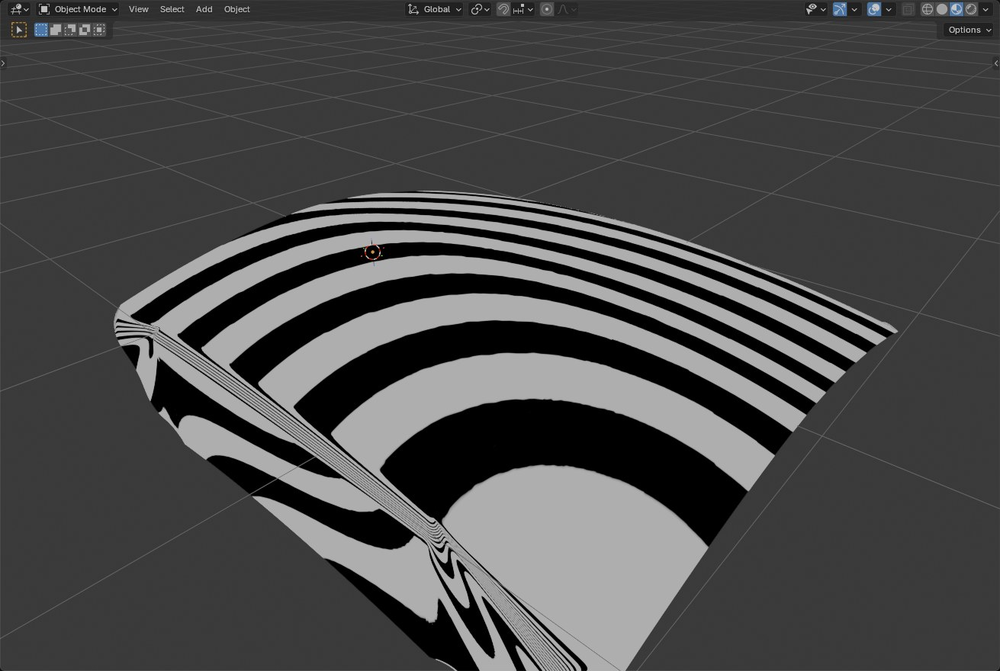
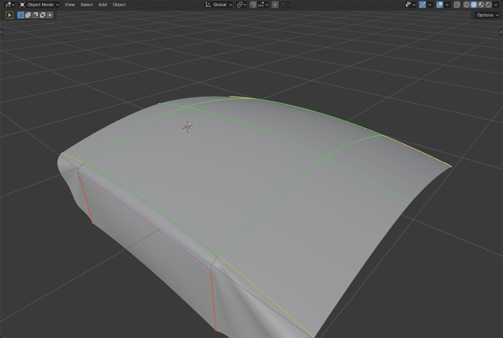
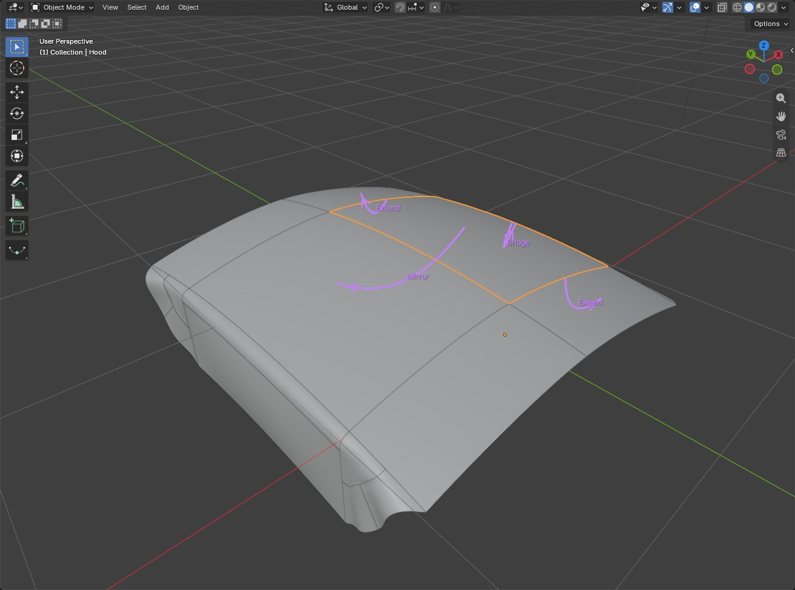
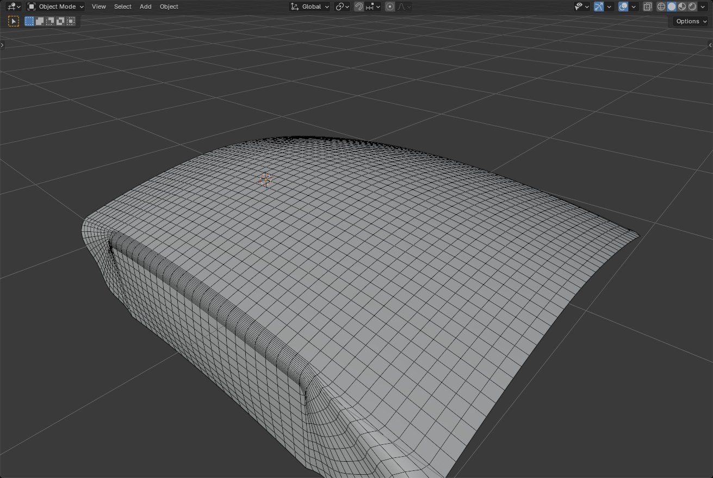
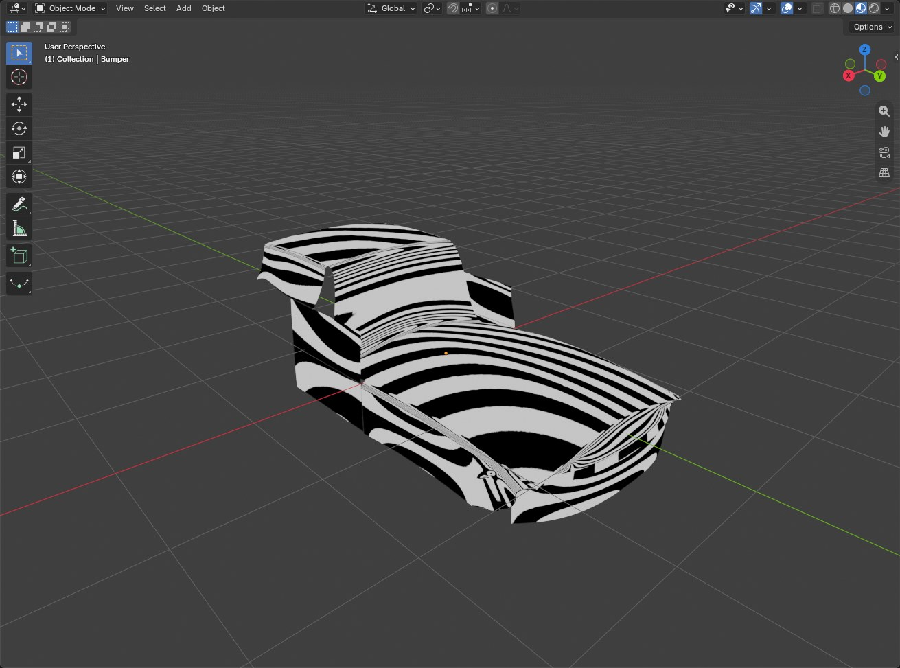
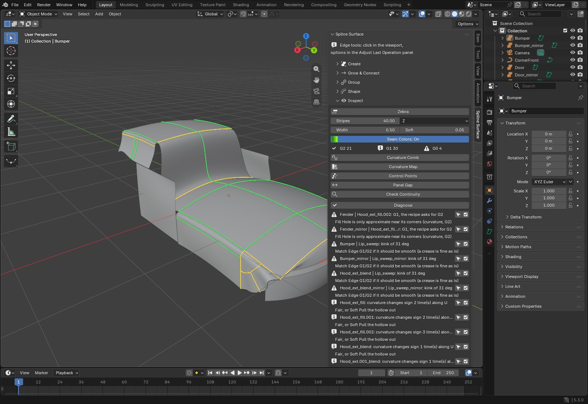

# Spline Surface

A Blender 5.x add-on for building smooth, car-body-like surfaces without NURBS expertise.
Surfaces are Blender NURBS surface patches; when the shape is right, weld them into one mesh.

| Seam continuity (Seam Colors) | Who follows whom (Follow Arrows) | Welded mesh (To Mesh) |
|---|---|---|
|  |  |  |

| The second sample (front of a body with its cabin) | Quality check (Diagnose) |
|---|---|
|  |  |

The full documentation is in Japanese (see `docs/MANUAL.md`). The panel and button names are in English.

## Install
1. Take `spline_surface-x.y.z.zip` (from `dist/` or the release).
2. In Blender: Edit > Preferences > Add-ons > menu at the top right > Install from Disk, and pick the ZIP (do not unpack it).
3. In the 3D Viewport press N: a **Spline Surface** tab appears.

Requires Blender 5.0 or later (tested with 5.3 on Windows; the automated tests also run on 5.0 under Linux).

## What it does
- **Edit curves**: grab any point of a curve and pull, the rest follows softly along the curve (range, falloff, pinned ends, crossing curves of a network follow); add a point exactly, slide a point along the curve, remove one and keep the neighbours' tangents (Curve Points; Slide / Dissolve in edit mode). Move points along their own tangent or normal, or change only handle lengths, keeping G2 (Constrained Move); make points G2 by handle lengths alone (Make G2); rebuild a curve with fewer points (Refit Curve); attach curve ends to other curves' ends (G0 / G1 / G2) or to patches (along or off the surface) (Attach Curve Ends); see every point's continuity in colour (Point Continuity); make a 3D curve from a side-view and a top-view curve (Two-View Curve), round corners (Curve Fillet), offset a flat curve (Offset Curve), lengthen ends naturally or straight (Extend Curve).
- **Join surfaces smoothly**: match neighbouring patches at G0 (position), G1 (tangent) or G2 (curvature). Extend an edge, bridge two edges, sweep an edge's shape along another edge, fill a corner or a hole, round a corner (Fillet), fold a wall off an edge (Flange), copy a patch edge out as a curve to build more patches from (Duplicate Edge as Curve).
- **Build from curves**: Coons patch from 3 to 4 boundary curves, Loft through section curves (click them in the order to pass through), Curve Network from a grid of crossing curves (G2 inside).
- **Body panel presets and blueprints**: start from a Hood, Roof, Door, Trunk, Bumper, Hood + Fender or Roof + Side; place side, front and top drawings at real size.
- **It remembers how a patch was made**: move a source patch or curve and everything built from it is rebuilt (Live Update); one Ctrl+Z takes back a tool and everything it rebuilt. Match Edge links a patch to its neighbour so it keeps following it, however far it moves. Follow Arrows draws who follows whom. Mirror Group keeps the other half in step.
- **Check the result**: seam colours (G2 green, G1 yellow, G0 red), zebra stripes, curvature comb and map, a continuity list that jumps to the worst seam, Diagnose (seams weaker than asked for, wavy patches, each with a suggested fix; mark what you meant and it stays hidden), panel gap measurement and Even Gap (even out a panel joint and keep it so).
- **Shape it**: Soft Pull, Fair, Refine, Add Row, Cage (lattice).
- **Output**: To Mesh welds the patches into one gap-free mesh, mostly quads. Edges shared by three or more patches are marked in a vertex group.

## Samples
`samples/hood_fender.blend` (a hood with its fenders) and `samples/body_front_cabin.blend` (the front of a body with its cabin), both built with this add-on only by `tools/build_sample_hood.py` and `tools/build_sample_body.py`.

## Not covered
- Trimming a hole into a patch (build openings from separate patches instead; see the manual).
- NURBS export (IGES / STEP). The output is Blender surfaces and meshes.

## Documents
- `docs/MANUAL.md` manual (Japanese), `docs/FEATURES.md` feature list, `docs/WORKFLOWS.md` six step-by-step workflows, `docs/CHANGELOG.md` history (in English), `docs/VALIDATION_body.md` what building the body sample turned up, `docs/CHECKLIST_hands_on.md` what to check by hand.
- Tests: `py tools/run_tests.py` runs all suites (`--no-gui` skips the two that open a Blender window).

## Reporting a bug
Select the patches involved and press **Copy Bug Report** in the **Help** panel at the bottom of the sidebar (it starts collapsed), then paste the text into a new issue at
https://github.com/hinatahugu29/spline_surface_engine/issues
together with what you did and what you expected. A small .blend that reproduces the problem helps a lot.
