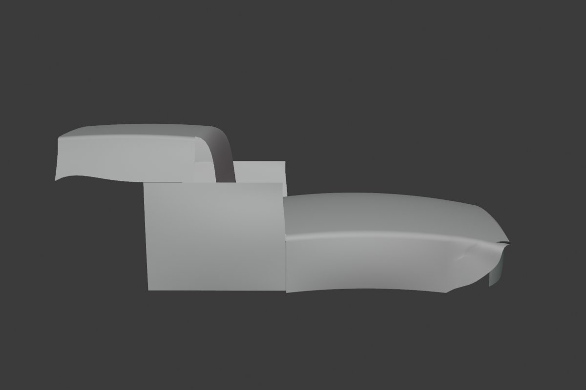
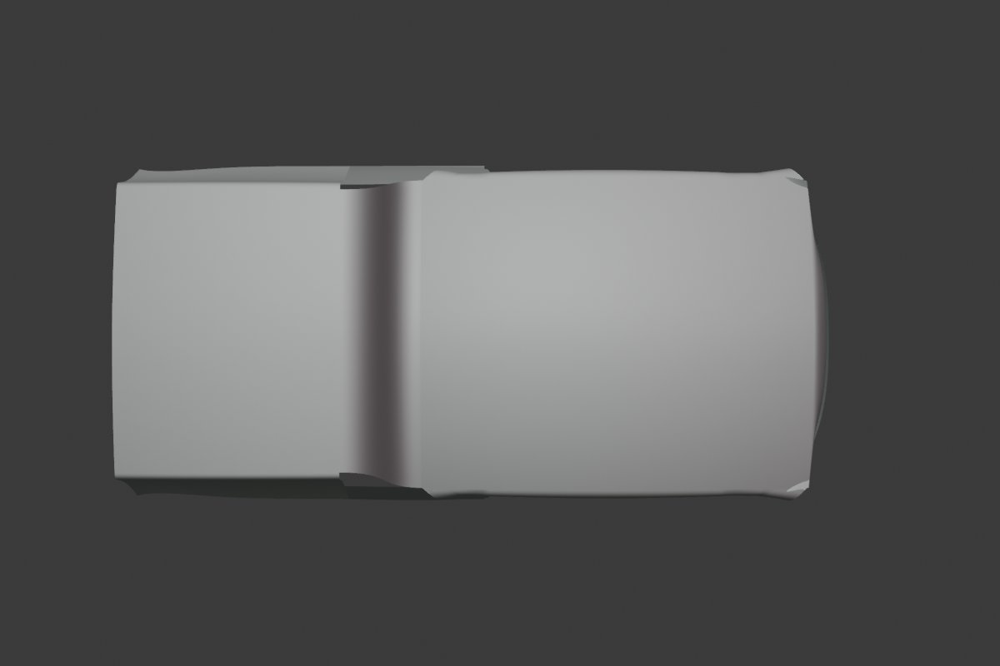

# 検証：車体の前半＋キャビン（v0.77.0、v0.82.3 まで更新）

`samples/body_front_cabin.blend` を作りながら、ツールの詰まりを拾った記録です。サンプルは `tools/build_sample_body.py` で毎回同じ手順で作り直せます。開いて全部を作り直すテストが `tests/test_body.py` です。

```
blender -b --factory-startup --python tools/build_sample_body.py -- [out.blend] [--render DIR]
```


| 横から | 上から | 斜め後ろから |
|---|---|---|
|  |  |  |

## 作ったもの（右半分を作って Mirror Group、計 36 枚。v0.77.0 では 34 枚）

| 部分 | 使った機能 |
|---|---|
| ボンネットとフェンダー | Fillet（肩）、Extend（ノーズとカウル、G2）、Fill Hole（前後の角、G2・Grid） |
| バンパー | 手で置いた面＋Bridge Edges（ノーズの先端から、G1） |
| キャビン | Roof + Side の Preset、Bridge Edges（カウルからルーフへ。フロントガラス） |
| ドア | Even Gap：前の縁をフェンダーへ、サイドの下の縁をドアの上の縁へ（4 mm、段差なし） |
| 窓の開口部 | Split Patch を2回：後ろの窓／B ピラーの帯／前の窓を別々の面に |
| モール | Sweep の Rotate（バンパーの上の縁に沿って、回り込みに合わせて断面を回す） |
| 出力 | Diagnose、To Mesh（6,352 面。v0.77.0 では 7,158 面） |

## 見つかって直したもの

| # | 詰まり | 直し方 | テスト |
|---|---|---|---|
| 1 | **Even Gap が、一部しか向かい合っていない縁で使えない**。ドアの前の縁（高さ 0.95）がフェンダーの後ろの縁（0.5）より長いと、「向かい合う辺がない」になった。車体ではむしろふつうの状態 | 向かい合う組の判定に部分的な重なりを認める（各辺の 1/6 以上、どちらかが 1/4 以上）。そろえるのは向かい合う部分だけで、はみ出した部分は元の位置にゆるく留まる | `test_core.test_even_gap_partial`、`test_body` |
| 2 | **Even Gap で、隣の面とのつなぎ目が開く**。Split で分けた面の1枚の縁をそろえると、縁の端が動いて隣の片との継ぎ目が切れた（黙って） | 開いた継ぎ目があれば警告で名前を出し、「分ける前にそろえる」か Match Edge を勧める | （手順はサンプルの順番に反映） |
| 3 | **Fillet で丸めた面を Split すると、相手の面が作り直せなくなる**。Roof＋Side の Side を分けると、Roof のレシピが「もうフィレットの一部ではない」で失敗した | Split のときに、同じフィレットの相手の面も今の形で固定する（フィレットの面と同じ扱い） | `test_blender`（Roof + Side を分けて作り直し） |
| 4 | **Diagnose が、わざと離した面を「開いた継ぎ目」と言う**。B ピラーの帯をはさんだ前後の窓（10 cm 離れている）が出た | 「開いた継ぎ目」は、大きさの 2% 以下の隙間（近いのに付いていない）だけにする | `test_core.test_diagnose`、`test_body` |

## 残っている詰まり（未対応）

| # | 内容 | 影響 | 考えられる対応 |
|---|---|---|---|
| A | ~~Fill Hole の角にひだが出る~~ → **v0.78.0 で対応**（下の「A の対応」） | | |
| A2 | ~~後ろの角の下側に、ねじれた三角が残る~~ → **v0.80.0 で解消** | 原因はツールではなくサンプルの配置：後ろの角の Fill とドアの前が、どちらもフェンダーの後ろの端に付いていて、同じ場所に2枚の面が重なっていた。ボディのサンプルでは後ろの角をドアに任せた（ボンネットのサンプルはドアがないので Fill を残す） | |
| A3 | ~~Fill Hole を3枚に分けた所の角度~~ → **v0.81.1 で解消** | 3枚どうしの継ぎ目は v0.81 で中心の作り方を直して G1（0.03〜0.09°）。フィレット側の「約 0.56°」は**面の問題ではなく測り方の誤り**だった：継ぎ目の両側の法線を、辺から少し内側（パラメータで 1e-4）で読んでいたため、急に曲がるフィレットでは両側が辺に沿って別の点を読んでいた。辺の上で読むように直すと 0.069°（G1）。ニュートン法で相手の面に正確に投影して測っても 0.067°、隙間 4.5 µm で一致。いまは Fill の継ぎ目がすべて 0.04〜0.09°（G1） | |
| A4 | ~~Diagnose は、辺の一部だけで接する継ぎ目を測れない~~ → **v0.80.0 で対応** | 辺の一部が相手の辺に載っている所を見つけ、そこで位置と角度を測る（曲率は測らない）。0.1% 以内だけを継ぎ目とみなすので、4 mm のパネルの隙間は継ぎ目にならない。あわせて、平均だけで「同じ辺」とみなしていた組み合わせ（Fill の1枚と長いフェンダーの辺で 12° と出た）を、実際に接している所の測定に切り替えた | |
| B | ~~Split Patch で、元の面の Match Edge・Even Gap の指定が消える~~ → **v0.79.0 で対応** | 切られない辺の指定はその辺を持つ片へ、切られた辺の Even Gap は相手に向かう片すべてへ。指定のない片は隣の片に付いていく（切れ目が割れない）。切られた辺の Match Edge は警告して外す | |
| C | **To Mesh で、3枚が1本の辺で出会うと非多様体になる**（モールの付け根。非多様体の辺 36、向きの食い違い 7） | v0.79.0 で警告を出し、頂点グループ non_manifold に入れるようにした | そういう面を別のメッシュにする選択肢 |
| D | ~~Diagnose は意図した形も波打ちとして出す~~ → **v0.80.0 で対応** | 行の右のチェックで「意図どおり」の印を面に付けると、次から出ない。印は一覧の下のボタンで消せる | |
| E | **A ピラーの部分が空いている**（フロントガラスの横、サイドの前、ドアの上の前寄り） | サンプルの形の問題（ツールの問題ではない） | Fill Hole（3辺）で埋める手順をサンプルに足す |

## 画面つきのランダム操作で見つかったもの（v0.82.1〜v0.82.3）

実機に触れない間の代わりに、Blender の画面を開いて、このサンプルの上で操作をランダムに続けさせた（移動、編集モードでの点の移動、ツール、Undo／Redo、削除、複製、名前の変更、保存と開き直し、To Mesh。80手を数通り）。あわせて、全部の操作を8つの状態（何も選ばない、面1枚・2枚・全部、カーブ、メッシュ、編集モード、回転・拡大した面）で呼ぶ確認（Python のエラー 0 件）と、全部のオブジェクトを1つずつ動かす確認、全体を 0.001 倍・1000 倍にする確認（結果は変わらない）をした。

| # | 詰まり | 直し方 | テスト |
|---|---|---|---|
| F | **Zebra をオンにして Ctrl+Z で、Blender が落ちる・固まる**（6回中5回） | 新しい面に縞を付ける処理が、Undo の記録の後に動いていた（隠れた Lip にも付けていた）。Undo で縞の材質が消えても Lip がそれを指したまま残り、次の復元で落ちた。各操作の中（Undo の記録の前）で、見えている面だけに付けるようにした | `test_body`（Lip に縞が付かない） |
| G | **File → Open で別のファイルを開くと、Live Update が止まる**（再起動するまで） | アドオンの更新処理に「ファイルを開いても残す」印がなく、Blender が外していた。全部に付けた | `test_body`（開き直して動かす） |
| H | **開いた直後の最初の1回の変更に付いてこない**（値の打ち込みなど） | 開いたときの元の面の状態を記録してから比べるようにした | `test_body` |
| I | **Refine の後の Ctrl+Z 1回で、ドアだけ戻ってミラーのコピーが戻らない**（Side では何も起きないように見えた） | 点の数が変わった面の作り直しが、自分の Undo の区切りを足していた。アドオンの操作の中で作り直すようにし、1回で両方戻るようにした | `test_body`、`test_gui` |
| J | **Ctrl+Z を2回以上押すと、付いてくる面が「手で直した面」になって止まる** | 作り方の記録（オブジェクトのプロパティ）を書いても、オブジェクトが変わったと記録されていなかった。Undo で点は古く戻り、記録は新しいまま残って食い違った。書いたときに記録するようにした | `test_gui`（離れた移動をまたいで2回 Undo） |
| K | **手で動かしたパネルのミラーのコピーが、Undo の後に付いてこない** | 手で直した面を、それを読む面の作り直しまで止めていた。手で直した形に付いていくようにした | `test_body` |

残っていること：アドオンの面をオブジェクトごと G で動かすと「手で直した面」になる（仕様）。Match Edge や Even Gap で付いていく面に Refine・Add Row をかけると、点の数が変わって以後付いていかない（説明書の 5.4 と「困ったとき」）。

## A の対応（v0.78.0）

原因：前後の角の穴は「4辺」で選んでいるが、フィレットの端と壁の端はまっすぐ続いていて（向きの変化 0°）、本当の角は3つしかない。四角形の1つの角を、まっすぐな所に置くことになり、そこから斜めにひだが出ていた。

対応：まっすぐ続く2辺（向きの変化 30° 未満で、同じ種類の辺）を1辺につなぎ、本当の角の数で埋める。三角形なら、角ごとの3枚（星形）で埋め、中心の位置と向きは、同じ穴を1枚で埋めたときの真ん中から取る（各辺の接平面から推すと、角を回り込む形では低すぎて、くぼみが出た）。つないだ辺は、両端とつなぎ目の点を正確に通るように作り直す（To Mesh がそこで溶接するため）。

| | 前（1枚） | 後（3枚） |
|---|---|---|
| フェンダーとの継ぎ目の角度 | 0.11° | 0.13° 以下（G1） |
| ボンネットの延長との継ぎ目 | 0.14° | 0.10° |
| 見た目 | 肩から斜めのひだ | 肩がそのまま角を回り込む（後ろの角は帯状の明るさの変化が少し残る） |

あわせて To Mesh：分けた Fill の辺は、フィレットの円弧を粗い直線でまたぐため、円弧の点がその直線から 5% 以上離れて溶接されず、小さな三角の穴が4つ残った。辺の両端で境界が曲がっている所だけ、溶接の許容を曲がりに応じて広げた（まっすぐな所と、パネルの隙間は 5% のまま。ボディのサンプルで、ドアとフェンダーの隙間がつながらないことを確認）。

古いレシピの Fill は形も枚数も変わらない（作り直したときに、1枚だった Fill が3枚の1つに変わってしまわないように）。新しく作る Fill から有効。

## 手で確かめてほしいこと

- `samples/body_front_cabin.blend` を開いて、ドアや窓をつかんで動かしたときの追従（ドアの前の縁はフェンダーに付いてくる。窓の下の縁は B のとおり付いてこない）
- Zebra で、Fill Hole の角（A）とフロントガラスの見え方
- Panel Gap をオンにして、ドアの前とベルトラインの色（緑になっているか）
