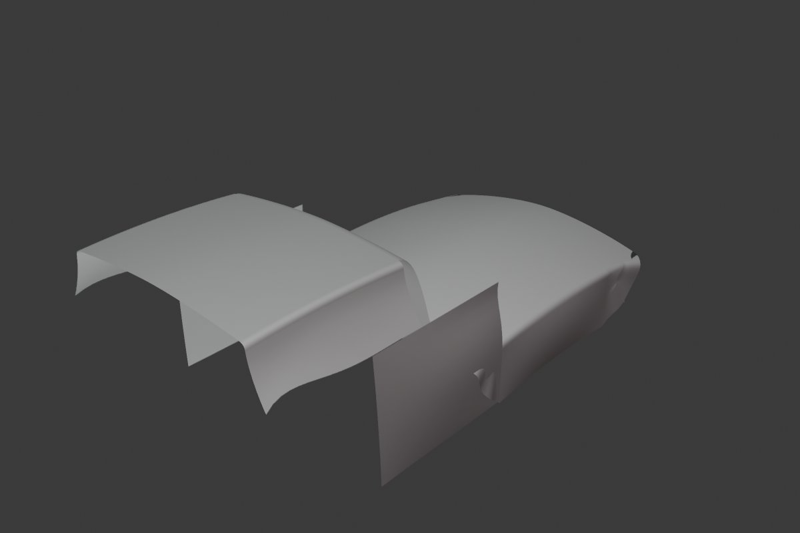

# 検証：車体の前半＋キャビン（v0.77.0、v0.78.0 で更新）

`samples/body_front_cabin.blend` を作りながら、ツールの詰まりを拾った記録です。サンプルは `tools/build_sample_body.py` で毎回同じ手順で作り直せます。開いて全部を作り直すテストが `tests/test_body.py` です。

```
blender -b --factory-startup --python tools/build_sample_body.py -- [out.blend] [--render DIR]
```


| 横から | 上から | 斜め後ろから |
|---|---|---|
|  |  |  |

## 作ったもの（右半分を作って Mirror Group、計 42 枚。v0.77.0 では 34 枚）

| 部分 | 使った機能 |
|---|---|
| ボンネットとフェンダー | Fillet（肩）、Extend（ノーズとカウル、G2）、Fill Hole（前後の角、G2・Grid） |
| バンパー | 手で置いた面＋Bridge Edges（ノーズの先端から、G1） |
| キャビン | Roof + Side の Preset、Bridge Edges（カウルからルーフへ。フロントガラス） |
| ドア | Even Gap：前の縁をフェンダーへ、サイドの下の縁をドアの上の縁へ（4 mm、段差なし） |
| 窓の開口部 | Split Patch を2回：後ろの窓／B ピラーの帯／前の窓を別々の面に |
| モール | Sweep の Rotate（バンパーの上の縁に沿って、回り込みに合わせて断面を回す） |
| 出力 | Diagnose、To Mesh（6,352 面。v0.77.0 では 7,158 面） |

## 見つかって直したもの

| # | 詰まり | 直し方 | テスト |
|---|---|---|---|
| 1 | **Even Gap が、一部しか向かい合っていない縁で使えない**。ドアの前の縁（高さ 0.95）がフェンダーの後ろの縁（0.5）より長いと、「向かい合う辺がない」になった。車体ではむしろふつうの状態 | 向かい合う組の判定に部分的な重なりを認める（各辺の 1/6 以上、どちらかが 1/4 以上）。そろえるのは向かい合う部分だけで、はみ出した部分は元の位置にゆるく留まる | `test_core.test_even_gap_partial`、`test_body` |
| 2 | **Even Gap で、隣の面とのつなぎ目が開く**。Split で分けた面の1枚の縁をそろえると、縁の端が動いて隣の片との継ぎ目が切れた（黙って） | 開いた継ぎ目があれば警告で名前を出し、「分ける前にそろえる」か Match Edge を勧める | （手順はサンプルの順番に反映） |
| 3 | **Fillet で丸めた面を Split すると、相手の面が作り直せなくなる**。Roof＋Side の Side を分けると、Roof のレシピが「もうフィレットの一部ではない」で失敗した | Split のときに、同じフィレットの相手の面も今の形で固定する（フィレットの面と同じ扱い） | `test_blender`（Roof + Side を分けて作り直し） |
| 4 | **Diagnose が、わざと離した面を「開いた継ぎ目」と言う**。B ピラーの帯をはさんだ前後の窓（10 cm 離れている）が出た | 「開いた継ぎ目」は、大きさの 2% 以下の隙間（近いのに付いていない）だけにする | `test_core.test_diagnose`、`test_body` |

## 残っている詰まり（未対応）

| # | 内容 | 影響 | 考えられる対応 |
|---|---|---|---|
| A | ~~Fill Hole の角にひだが出る~~ → **v0.78.0 で対応**（下の「A の対応」） | | |
| A2 | **後ろの角の下側に、ねじれた三角が残る**（閉じるカーブがフェンダーの下の角に鋭い角度で入る所） | サンプルの閉じるカーブの形による。A とは別 | 閉じるカーブの向きをサンプル側で直す、または Fill Hole で鋭い角を検出して知らせる |
| A3 | **Fill Hole を3枚に分けた中心で、面どうしが 0.03〜0.26° 折れる**（中心点の付近だけ。そのほかは 0.00°） | 3つの角の星形の配置の性質（以前から 5辺以上の穴で同じ） | 中心のまわりの接平面の合わせ方を見直す |
| A4 | **Diagnose は、分けた Fill の1枚が隣の辺の一部だけに付いている継ぎ目を測れない**（辺どうしが丸ごと一致する継ぎ目しか見ない） | その継ぎ目の G1/G2 が一覧に出ない（テストでは別の方法で 0.13° 以下を確認） | 辺の一部どうしの継ぎ目も測れるようにする |
| B | **Split Patch で、元の面の Match Edge・Even Gap の指定が消える**。切った面はその時点の形で固定されるので、ドアを動かしても窓の下の縁は付いてこない | 分けたあとの追従が切れる | 切られない辺の指定は、分けた両方の片に引き継ぐ |
| C | **To Mesh で、3枚が1本の辺で出会うと非多様体になる**。モールがバンパーとノーズのブリッジの継ぎ目に付いている所で、非多様体の辺 36、向きの食い違い 7 | 折り目として付けたモールでは避けられないが、報告はない | To Mesh で、3枚以上が出会う辺を報告する（または、そういう面を別のメッシュにする選択肢） |
| D | **Diagnose は意図した形も波打ちとして出す**。ドアの膨らみからタンブルホーム（上が内に倒れる）への S 字や、G1 でつないだフロントガラスの S 字 | 誤報ではないが、直す必要のないものも並ぶ | 行ごとに「意図どおり」と印を付けて次から出さない |
| E | **A ピラーの部分が空いている**（フロントガラスの横、サイドの前、ドアの上の前寄り） | サンプルの形の問題（ツールの問題ではない） | Fill Hole（3辺）で埋める手順をサンプルに足す |

## A の対応（v0.78.0）

原因：前後の角の穴は「4辺」で選んでいるが、フィレットの端と壁の端はまっすぐ続いていて（向きの変化 0°）、本当の角は3つしかない。四角形の1つの角を、まっすぐな所に置くことになり、そこから斜めにひだが出ていた。

対応：まっすぐ続く2辺（向きの変化 30° 未満で、同じ種類の辺）を1辺につなぎ、本当の角の数で埋める。三角形なら、角ごとの3枚（星形）で埋め、中心の位置と向きは、同じ穴を1枚で埋めたときの真ん中から取る（各辺の接平面から推すと、角を回り込む形では低すぎて、くぼみが出た）。つないだ辺は、両端とつなぎ目の点を正確に通るように作り直す（To Mesh がそこで溶接するため）。

| | 前（1枚） | 後（3枚） |
|---|---|---|
| フェンダーとの継ぎ目の角度 | 0.11° | 0.13° 以下（G1） |
| ボンネットの延長との継ぎ目 | 0.14° | 0.10° |
| 見た目 | 肩から斜めのひだ | 肩がそのまま角を回り込む（後ろの角は帯状の明るさの変化が少し残る） |

あわせて To Mesh：分けた Fill の辺は、フィレットの円弧を粗い直線でまたぐため、円弧の点がその直線から 5% 以上離れて溶接されず、小さな三角の穴が4つ残った。辺の両端で境界が曲がっている所だけ、溶接の許容を曲がりに応じて広げた（まっすぐな所と、パネルの隙間は 5% のまま。ボディのサンプルで、ドアとフェンダーの隙間がつながらないことを確認）。

古いレシピの Fill は形も枚数も変わらない（作り直したときに、1枚だった Fill が3枚の1つに変わってしまわないように）。新しく作る Fill から有効。

## 手で確かめてほしいこと

- `samples/body_front_cabin.blend` を開いて、ドアや窓をつかんで動かしたときの追従（ドアの前の縁はフェンダーに付いてくる。窓の下の縁は B のとおり付いてこない）
- Zebra で、Fill Hole の角（A）とフロントガラスの見え方
- Panel Gap をオンにして、ドアの前とベルトラインの色（緑になっているか）
